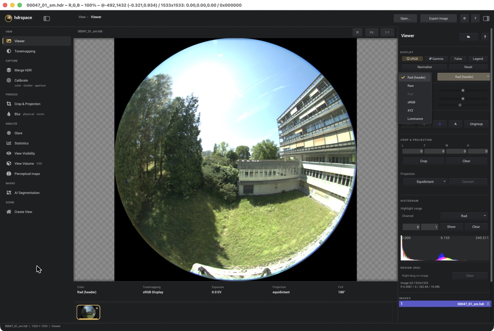

# hdrspace

hdrspace is a macOS app (with a Windows build) for HDR photography where the pixel values
are meant to be measurements. It turns a bracket of camera RAW files into a Radiance HDR image in absolute
units (luminance in cd/m², colour in CIE XYZ or Radiance / linear sRGB primaries), and has
tools to analyse that image: glare, visibility, tone mapping and a few perceptual maps.

I use it for daylighting and visual comfort research. Ordinary raw converters add tone
curves and white balance, so their output can't be used for luminance. hdrspace keeps the
whole chain linear and writes every step into the file header, so each result can be traced
back to the RAW files and settings that made it.

The app is developed and tested on Apple Silicon Macs and needs macOS 26 or newer. A 64-bit
Windows build is also available, with a few tools missing; see [Windows](#windows).

**Download:** [hdrspace 1.01](https://github.com/dhkim-research/hdrspace/releases/tag/v1.01).
On a Mac, unzip `hdrspace-macos-arm64.zip` and move `hdrspace.app` to Applications. The app
is not notarized, so open it the first time with right-click → Open.

**New here?** The [usage guide](docs/usage.md) walks through the app with screenshots.



## Camera RGB to calibrated colour and luminance

The engine is `mergehdr` ([`mergehdr/`](mergehdr)), a C++ re-implementation of Stephen
Wasilewski's linearhdr / pylinearhdr method.

1. **RAW decoding** with LibRaw: per-frame black level, no tone curve, no white balance.
2. **Exposure** of each frame from shutter, aperture and ISO, with optional fitted
   corrections for the real shutter times and apertures of your camera
   (`mergehdr shutter`, `mergehdr aperture`). Mixed-aperture brackets work.
3. **Merging**: the faster *pixel* weighting (from hdrmerge, the default) or *neighborhood*
   weighting (from linearhdr; frames with clipped pixels nearby are left out, against sensor
   bloom), and AHD (the default) or DHT demosaicing. The two are chosen separately; *Bloom
   prevent* (`--bloom-prevent`) sets neighborhood weighting with DHT.
4. **Colour**: camera RGB → XYZ with the camera matrix from the RAW file, or one fitted to a
   photographed colour chart (`mergehdr colorcalibrate`, `mergehdr chartcells`). Output in
   Radiance RGB, linear sRGB or XYZ, with the primaries stored in the header, or in raw
   camera RGB (no primaries and no `LuminanceRGB`).
5. **Geometry**: fisheye reprojection (equisolid → equidistant, or a measured lens curve),
   vignetting correction from an angle table, and a Radiance `VIEW` line.
6. **Sun**: `shadowband` combines shadowband and ND-filter captures so the solar disc is not
   clipped.

Pixel values are stored in Radiance units (W·sr⁻¹·m⁻², i.e. cd/m² ÷ 179) whatever the output
colour space, and the luminance weights for that space are written to the header as
`LuminanceRGB` (the Y row of its RGB → XYZ matrix). Luminance is therefore
`L = 179 × (w_R R + w_G G + w_B B) / EXPOSURE`, where `EXPOSURE` is the product of any
`EXPOSURE=` lines in the header (1 if there are none):

| Output | w_R, w_G, w_B | Luminance |
|---|---|---|
| Radiance RGB | 0.265, 0.670, 0.065 | `179 × (0.265 R + 0.670 G + 0.065 B)` |
| linear sRGB (Rec. 709) | 0.2126, 0.7152, 0.0722 | `179 × (0.2126 R + 0.7152 G + 0.0722 B)` |
| XYZ | 0, 1, 0 | `179 × Y` |

Glare, Perceptual maps, Statistics and the viewer's luminance read-out read Radiance files
(`.hdr`, `.pic`, `.rgbe`) this way. View Visibility instead converts with the primaries chosen
in its *Input color* menu (header `EXPOSURE=` lines are still undone). EXR files are read as
they are stored. The EXR files hdrspace writes (the Merge HDR output and *Export image*) hold
cd/m², i.e. the Radiance values × 179 ÷ `EXPOSURE`, with the primaries as EXR chromaticities.

Only header lines that start at the left margin describe the picture; indented lines are the
headers of input pictures that a program such as `pcomb` or `pcompos` copied. `EXPOSURE` and
`VIEW` count only at the left margin, as in Radiance. When the top lines carry no colour keys
(`LuminanceRGB`, `PRIMARIES`, `TargetPrimaries`, `XYZCAM`, ...), they are taken from the nearest
copied header. Every tool reads headers with this one rule (`mergehdr/hdrimage.h`).

An XYZ file that already holds cd/m², for example one written by another program, can be
marked as *XYZ (cd/m²)* in the viewer (only Radiance files without a colour header). The
viewer, Statistics, Glare, Blur, extract and gaze tone mapping then leave out the ×179. In View
Visibility, choose *CIE XYZ (cd/m²)* as Input color (`--input-color xyz-cdm2` for
`mergehdr view_visibility`).

The absolute scale comes from the exposure model, so check a new camera and lens against a
luminance meter before relying on absolute values.

## Tools in the app

- **Viewer**: pixel values in the file's colour space or converted (Rad, sRGB, XYZ,
  luminance), false colour, histograms, region statistics. Files without colour information
  are shown as *Unknown* until you say what they are.
- **Merge HDR / Calibrate**: the pipeline above, plus colour, shutter and aperture
  calibration. The shadowband step is only on the command line (`mergehdr shadowband`), and a
  vignetting table or fitted shutter and aperture corrections come from a profile file or the
  *Extra arguments* box.
- **Glare**: DGP, DGI, UGR, glare sources, bands and zones, based on evalglare 3.06.
- **View Visibility**: how much of a view's detectable contrast is kept in a second image
  (e.g. with blinds), using the visibility stages of HDR-VDP 3.
- **Perceptual maps**: cone and rod response, local adaptation, detectable contrast and
  equivalent luminance, with pixels per degree read from the `VIEW` header.
- **Statistics**: whole-image, rectangle, circle (by opening angle) and mask statistics, row
  and column profiles, and CSV and region-HDR export.
- **Tonemapping**: pfstools operators and Radiance `pcond` (Ward).
- **Crop & Projection, Blur, Create View** (Radiance rendering), and **View Volume /
  AI Segmentation** (SAM 3 and Depth Anything 3). Depth Anything 3 is installed with the
  *Install DA3 Metric* button (needs Homebrew Python 3.12 or 3.13). SAM 3 needs an MLX SAM3
  runtime that is already in `~/Library/Application Support/hdrspace/mlx-sam3-runtime`.

## Based on, and what changed

| Based on | Licence | What hdrspace changed |
|---|---|---|
| [tev](https://github.com/Tom94/tev) (Thomas Müller) | GPL-3.0 | Kept the viewer; added the tool rail, inspectors, analysis panels, colour-space handling, crop/projection and perceptual maps. |
| [linearhdr / pylinearhdr](https://github.com/stephanwaz/linearhdr) (Stephen Wasilewski) | LGPL-3.0 / GPL-3.0 | Re-implemented in C++; added calibration, projection and vignetting tools. |
| [hdrmerge](https://github.com/wjakob/hdrmerge) (Wenzel Jakob) | GPL-3.0 | Used for the fast merge path. |
| evalglare (J. Wienold, Fraunhofer ISE / EPFL) | Evalglare License 3.0 | Ported to C++; angles in degrees; equivalent-luminance and local-only modes added. This software uses a modified version of the source code of evalglare. |
| [HDR-VDP 3](https://sourceforge.net/projects/hdrvdp/) (Rafał Mantiuk) | BSD-3-Clause | Visibility and detectable-contrast stages ported from MATLAB to C++. |
| [Radiance](https://www.radiance-online.org/) (LBNL) | Radiance License 2.0 | Command-line tools bundled for `pcond` and rendering. |
| [pfstools](http://pfstools.sourceforge.net/) | GPL / LGPL | Called as external programs for tone mapping. |
| NanoGUI (Wenzel Jakob), NanoVG (Mikko Mononen) | BSD-3-Clause / zlib | Restyled dialogs, menus and tooltips. |

Known differences from the originals, all intentional: the glare output adds a `dgm`
column, uses the header's `LuminanceRGB`, divides `av_lum_pos2` once, and computes
`r_contrast` (an uninitialised value in the original). Very dark pixels (a few tens of DN)
are slightly more precise than in pylinearhdr because there is no 16-bit TIFF step.

Licence texts for the bundled components are in `hdrspace/assets/licenses`. The Windows
package also gets the BusyBox (busybox-w32) licence note when it is built.

## Windows

Download `hdrspace-windows-x64.zip` from the
[1.01 release](https://github.com/dhkim-research/hdrspace/releases/tag/v1.01),
unzip it anywhere and start `hdrspace-windows-x64\bin\hdrspace.exe`. The program is not
code-signed, so Windows may show a SmartScreen warning the first time ("More info" → "Run
anyway"). Newer builds are made by GitHub Actions when `hdrspace/`, `mergehdr/` or the
workflow change, or when the workflow is started by hand (workflow "hdrspace Windows app",
package `hdrspace-windows-x64`). Nothing else has to be installed: the
package contains `mergehdr`, the Radiance programs, the HDR-VDP data, the camera profiles and a
small POSIX shell (BusyBox) that runs the background jobs.

Not available on Windows:

- **AI Segmentation** and **View Volume**.
- The **pfstools** tone-mapping operators. Radiance `pcond` (Ward '97) works.

Each build is checked on a Windows Server virtual machine with software OpenGL. `mergehdr` and
the Radiance programs run in the package, and the app opens an HDR image, computes Glare and
Perceptual maps and saves screenshots. The numbers are compared with the macOS reference
results for the `mergehdr` command line, in the separate "mergehdr Windows" workflow. The app
has not yet been tested on a Windows PC with a real graphics card. The command-line tools
alone are described in [mergehdr/README.rst](mergehdr/README.rst#windows).

## Building

```
hdrspace/   the app (C++, NanoGUI, vendored tev)
mergehdr/   the HDR engine and command-line tool
```

Requirements: Xcode command-line tools, CMake, Ninja, pkg-config, and Homebrew OpenEXR,
Imath, jpeg-turbo, little-cms2, Exiv2, LibRaw, Boost (1.90 or newer), FFTW, Eigen and libomp.
pfstools is optional.

Building and packaging also need a runtime payload that is not in this repository; CMake does
not configure without it. Place it at `hdrspace-baseline/payload` next to these folders, then:

```
cd hdrspace
python3 tools/build_hdrspace.py --work-dir /tmp/hdrspace-build
```

`hdrspace/tools/baseline_payload_manifest.json` records the payload: the SHA-256 of each of its
586 files, the Radiance build, and the Homebrew release whose machine code matches each
library. `build_hdrspace.py` checks the payload against it before building and names the files
that differ. It also stops unless each Homebrew library is that exact release. The payload
holds:

- `Contents/Resources/radiance`: Radiance 6.1a (`rpict -version`: LBNL, 2025-10-21,
  7e412c84d6), `bin` and `lib`. `rtrace.pre_progress_20260327` is a byte-identical copy of
  `rtrace`, which packaging leaves out.
- `Contents/Frameworks`: the 24 Homebrew libraries that the app and the helpers load (releases
  in the manifest). `tools/bundle_macos_helpers.py` copies the libraries a helper links into
  an app bundle and rewrites their install names.
- `Contents/MacOS/mergehdr` and `mergehdrcore` (arm64). The build replaces them with helpers
  built from `mergehdr/`.
- `Contents/Resources/hdrvdp3/data`: the same files as `hdrspace/assets/hdrvdp3-data`.
- `Contents/Resources/ai`: the AI helper scripts. `mlx_sam3_mask_helper.py` equals
  `hdrspace/tools/mlx_sam3_mask_helper.py`; packaging takes the two DA3 scripts from
  `mergehdr/tools`.
- `Contents/profiles`: camera profiles (some are also in `mergehdr/profiles`).

After a deliberate change of the payload, run the helper checks again
(`mergehdr/tests/crossplatform`) and record it with
`python3 tools/build_hdrspace.py --update-payload-manifest`. The app and its helpers are built
for one macOS version, `MACOS_DEPLOYMENT_TARGET` in `build_hdrspace.py` (26.0). Packaging
writes it as the app's minimum system version and stops if a bundled program or library needs
a newer one.

The engine alone builds with CMake:

```
cd mergehdr
cmake -S . -B build-mergehdr -DCMAKE_BUILD_TYPE=Release
cmake --build build-mergehdr -j
```

### gui-test (macOS)

To check the interface without anyone driving the mouse, start the app with `--gui-test`:

```
hdrspace.app/Contents/MacOS/hdrspace --gui-test /tmp/gui-test mergehdr/tests/crossplatform/data/a47.hdr
```

It opens every tool in the rail in turn, plus the lower part of the Viewer, the Calibrate
pages, a perceptual map computed on its background job, the Create View 3D, Top and HDR tabs
(not Preview), Settings and Help, saves a PNG of the window for each and a list in
`gui-test.txt`, then quits. `--size 1440x900` sets the
window size (the default).
The app reads back its own Metal frames, so macOS asks for no screen-recording permission.
On Windows the GitHub Actions workflow takes the screenshots instead.

### Other start options

Image paths after the program name open at start. `--export-create-view-turntable` writes a
Create View turntable video (`--room`, `--view`, `--env`, `--output`, `--size`, `--frames`,
`--fps`, `--zoom`, `--env-alpha`, `--bg`).

## Licence

GPL-3.0 (see `LICENSE`). `mergehdr` keeps its GPL and LGPL texts in `mergehdr/COPYING` and
`mergehdr/COPYING.LESSER`.

Dong Hyun Kim, 2026
